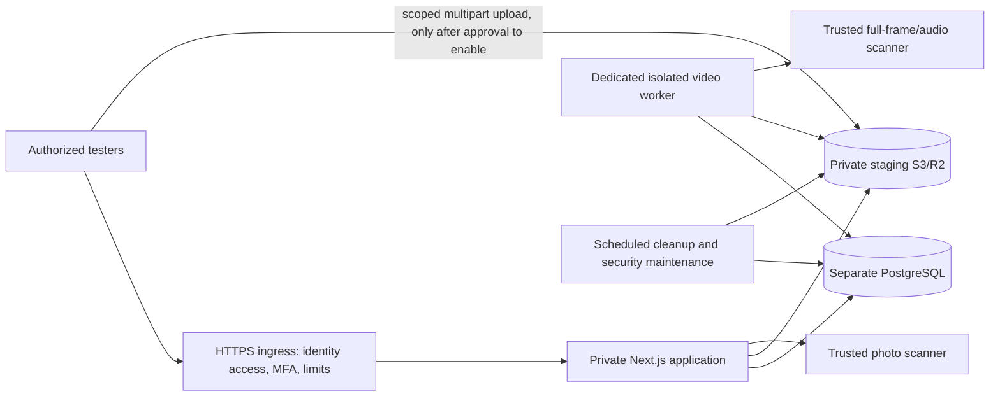

# Phase 4A: staging readiness and production hardening

This phase prepares **private, synthetic-data staging**. It provisions no hosting,
paid services, production accounts or public deployment. Stripe remains disabled.
Photo/video intake and signup default to disabled outside development. Existing
profiles, moderation, social features, private media and demos are preserved.

## Implemented changes

- Runtime configuration validation before binding via the supported `pnpm start`
  entrypoint, with `instrumentation.ts`/request-gate defense in depth, and
  `pnpm config:check`. Invalid settings name the failing fields, never their
  values. Use `pnpm start` rather than bypassing the entrypoint with `next start`.
  Next instrumentation may initialize lazily on the first request. Hosted startup also verifies database TLS/connectivity and rejects
  superuser, database/role administrator, schema/table owner and unsafe staff/audit
  write permissions. Build-time collection skips runtime connectivity checks.
- Explicit development/staging/production modes, trusted HTTPS origin/host,
  secure host-only session cookies, no-cache staging responses and basic security
  headers. Development requires a loopback base URL and Host; it must bind to
  loopback and never be publicly reverse-proxied.
- A staging Basic-auth defense covering pages, APIs, static files, robots and
  media, independent of application session cookies. Hosting/edge identity access
  remains the recommended primary gate. Direct binary handlers enforce the same
  gate before reading streams: stable Next's middleware body clone would otherwise
  buffer/truncate uploads and change cleanup races. Unknown routes remain gated.
- Closed staging signup at both page and server-action layers; independent media
  and video intake switches; background video processing remains disabled without
  explicit feature approval and independent isolation-verification reference.
- Database session versions, strict JWT claim/expiry validation, revocation on
  password change/sign-out/deletion, and stale-version/password checks before
  changing passwords or deleting accounts. The current password-change session is
  renewed; other sessions expire immediately on their next authorization check.
  Sign-out intentionally revokes all sessions for that account.
- Persistent HMAC-keyed sign-in/registration/account-change limits, normalized
  email lookup, transactional registration, bounded bcrypt password input, explicit
  action CSRF checks and no password fields returned in action error state.
  Team members cannot manage invitations/members or acquire platform staff rights.
- Staff authorization takes the account lock used by the manual operator script
  **before** reading permission. This preserves revocation coordination while
  allowing the application read-only access to `platform_staff`. No public
  permission-granting endpoint was added.
- Public user DTOs explicitly select permitted fields; session version/password
  hashes remain server-side. Account deletion is soft, revokes sessions, removes
  memberships and replaces the login email with a nonpersonal tombstone. Associated
  moderation/evidence retention still follows Phases 2B/3A/3B.
- Restricted service diagnostics, cleanup run tracking and bounded pruning of
  authentication windows older than 24 hours. Native worker logs add structured,
  narrowly typed events without request bodies, headers, URLs, credentials or raw
  error objects. Proxy/hosting logs require their own redaction controls.
- Patched stable Next.js **15.5.28**, React/React DOM **19.1.10**, Drizzle ORM
  **0.45.4**, Drizzle Kit **0.31.11**, PostCSS **8.5.30** and scoped patched
  transitive dependencies. Canary-only PPR/client-segment flags were removed;
  authenticated/database pages render at request time and real 404s remain.
  Weekly Dependabot configuration covers packages and pinned GitHub Actions.

Migration `0007_sudden_jean_grey.sql` only adds `users.session_version` (default 0),
`auth_rate_limits`, `service_runs`, checks and an index. No existing data/table is
removed. Existing unrevoked sessions map to version 0. Legacy case-duplicate
emails need operator review before launch; no destructive deduplication/index
migration was attempted. New application registrations/account email edits use
normalized email and advisory locks. New passwords must fit bcrypt's 72 UTF-8
bytes; existing longer passwords can still sign in and be changed.

## Recommended runtime architecture

The recommendation follows the actual synchronous photo, asynchronous video,
private range-delivery and database requirements in the repository. It does not
assume a hosting vendor or measured costs.



- **Application:** container/VM capable of persistent Next.js Node processes,
  private streaming responses, native Sharp and bounded photo requests. Start with
  approximately 1–2 vCPU / 2 GiB memory and measure representative load. The app
  still decodes photos in its process; use strong ingress limits and keep photo
  intake off until the target runtime is reviewed. Generic serverless body/time
  ceilings may be incompatible with the existing 10 MiB photo route.
- **Database:** isolated managed PostgreSQL or privately operated PostgreSQL with
  certificate-verified TLS, restricted ingress, separate app/operator/worker/
  cleanup credentials, backups and restoration drills. Initial 2 vCPU / 2–4 GiB
  planning is illustrative; connection/data/load measurements determine sizing.
  Application connections have a five-second connect timeout and ten-second
  statement timeout. Health probes use a separate small, bounded pool.
- **Storage:** a separate private staging bucket and least-scoped credentials,
  verified anonymous-read/list denial, exact-origin upload CORS, budgets and audit
  logging. No public domain/ACL. R2/S3 live policy/compatibility remains unverified.
  Existing records identify a driver, not a bucket: never point staging at a
  production bucket or switch buckets while retaining incompatible records.
- **Worker:** dedicated patched Linux hosting that actually permits the Phase 3B
  Bubblewrap namespaces/mount restrictions. Do not run the native pipeline in
  Next.js requests. Initial per-active-job planning: about 2 vCPU / 3 GiB memory,
  at least 257 MiB scratch plus retry/orphan headroom; enforce cgroup memory/PID/
  volume caps and monitor. Two global leases is a queue cap, not host isolation.
- **Scheduler:** `pnpm media:cleanup --apply` approximately every five minutes,
  with bounded retries and alerting; `pnpm security:prune` also works independently
  when uploads are off. Review retention/legal holds before enabling deletion.
- **Ingress:** HTTPS, identity-based tester allowlist and MFA, body/rate/time limits,
  no shared caching of authenticated/API/media/staging responses, restricted direct
  backend access and private service networking. Overwrite forwarded headers;
  never trust client-supplied forwarding/IP headers. Restrict outbound worker
  access to DB/storage/scanners; the decoder namespace gets no network/secrets.
- **Observability/backups:** restricted central structured logs, queue/cleanup/
  scanner alerts, database PITR/snapshots, encrypted media/version retention and
  documented incident ownership. No cost estimate is presented as a measured bill;
  budget storage requests/ingress/egress, repeat uploads, CPU/scanning and staff.

Avoid exposing development servers, Drizzle Studio, PostgreSQL, health tokens,
worker controls or storage origins. A hosting/edge layer must enforce direct-origin
blocking and authenticated access; app Basic auth is an additional shared-secret
gate, not individual identity, a WAF, MFA or a provider provisioning mechanism.

## Environment inventory

Use server-side environment delivery; never prefix secrets with `NEXT_PUBLIC_`.
`NODE_ENV` is managed by Next (`production` for hosted start). An omitted
`APP_ENV` supports legacy loopback development only; a remote base URL fails
validation rather than silently becoming production.

| Setting | Development | Hosted staging / production |
| --- | --- | --- |
| `APP_ENV` | `development`, or legacy unset on loopback | Explicit `staging` / `production` |
| `POSTGRES_URL` | Isolated local database | Separate environment DB, `sslmode=verify-full`, trusted CA; restricted app role |
| `AUTH_SECRET` | Strong random value, at least 32 characters | Independent per environment, app only; rotate securely |
| `BASE_URL` | Loopback HTTP(S) origin, no path/query | Exact HTTPS origin, no path/query |
| `SESSION_COOKIE_SECURE` | Cookies are always secure regardless | Must be `true` for app |
| `TRUSTED_ORIGINS` | Loopback request Origin/Host checked | Exactly the base HTTPS origin; no wildcard; app only |
| `TRUSTED_CLIENT_IP_HEADER` | Optional for local fixture abuse checks | Must be `x-mimi-client-ip`, overwritten by trusted ingress; app only |
| `STAGING_ACCESS_USERNAME`, `STAGING_ACCESS_PASSWORD` | Unused | Staging app requires username + independent strong random password |
| `STAGING_DATA_ISOLATED` | Unused | Staging requires `true` **after operator verification**; not proof of isolation |
| `SIGNUP_ENABLED` | Defaults on | Defaults off; no approval to enable is supplied by this task |
| `MEDIA_UPLOADS_ENABLED` | Legacy local behavior unless explicitly false | Defaults off; explicit true requires private storage/photo scanner |
| `VIDEO_UPLOADS_ENABLED`, `VIDEO_WORKER_ENABLED` | Local synthetic fixture behavior; worker CLI explicitly invoked | Defaults off; both true required with verified isolation/scanner/storage |
| `PAYMENTS_ENABLED` | `false` | Must be `false`; startup rejects opt-in |
| `STRIPE_SECRET_KEY`, `STRIPE_WEBHOOK_SECRET` | Not required; leave absent | Not required; leave absent |
| `MEDIA_STORAGE_DRIVER`, `MEDIA_LOCAL_ROOT`, `MEDIA_SCAN_MODE` | Optional private local adapter + `development-manual` on loopback | Local/manual modes forbidden, including when intake is off |
| `MEDIA_S3_ENDPOINT/REGION/BUCKET/ACCESS_KEY_ID/SECRET_ACCESS_KEY` | Optional; no real cloud keys needed by tests | Separate private bucket/settings if media configured; required for intake |
| `MEDIA_HEALTHCHECK_KEY` | Not needed for local fixtures | Existing benign random `64hex.webp` canary, 1–1024 bytes, for read-only HEAD probe |
| `MEDIA_SCANNER_URL/TOKEN`, `MEDIA_SCANNER_HEALTH_URL` | Manual fixtures only when explicitly local | Required before enabling photo intake |
| `VIDEO_SCANNER_URL/TOKEN`, `VIDEO_SCANNER_HEALTH_URL` | Manual fixtures only when explicitly local | Required before enabling videos/worker |
| `VIDEO_WORK_ROOT`, `VIDEO_FFMPEG_PATH`, `VIDEO_FFPROBE_PATH` | Private directory outside repo; default `/usr/bin` binaries | Private bounded volume + patched installed binaries |
| `VIDEO_SANDBOX_MODE` | Explicit `development-prlimit` only for isolated synthetic local fixtures | `bwrap` only; no fallback |
| `VIDEO_ISOLATION_VERIFICATION` | Not needed for local fixtures | Independent reviewed runtime/deployment reference, 8–160 safe characters; an operator attestation, not a sandbox test |
| `HEALTHCHECK_TOKEN` | Optional independent strong token | Optional independent infrastructure token, restricted by network/edge too |
| `NODE_USE_SYSTEM_CA`, `NODE_EXTRA_CA_CERTS` | Use supported trusted system/additional CA for proxy fonts or test DB | Use platform trust bundle; never disable TLS verification |

Background workers/cleanup validate their service settings without requiring web
session, cookie, IP-header or site-gate secrets. Use different DB/storage identities
for each service. Native children receive a cleared environment and restricted
mounts. CI-only `TEST_*` variables and temporary credential files are test harness
inputs, not hosted application settings; keep operator credentials outside the
application/worker filesystem in real hosting.

## Private staging setup (operator review required, no deployment performed)

1. Choose a provider/runtime with the boundaries above. Configure an identity-aware
   edge/hosting gate with named tester accounts, MFA and explicit allowlists. Block
   public/direct origin access. Do not rely on robots or an obscure URL.
2. Create a **separate** staging database, app role and private bucket. Inspect
   resource/account identifiers and credentials independently of production. Do
   not import production data, media, session secrets, staff identities or backups.
   Keep only synthetic test accounts/media. Restrict the bucket even while intake
   is disabled; actual bucket privacy must be independently verified.
3. Review `.env.staging.example`; fill values in the provider's secret manager.
   Generate independent random secrets (for example 32 random bytes encoded as
   hex). Never paste them into PRs/logs/chat. Set `STAGING_DATA_ISOLATED=true` only
   after verifying DB/bucket/data separation. The code cannot prove that assertion.
4. Configure the proxy to preserve the canonical Host and **overwrite**
   `X-Forwarded-Proto: https` and `X-Mimi-Client-IP` with a validated single client
   IP. Strip inbound equivalents and restrict network access to the proxy.
   These headers are not cryptographic proof of an ingress. The app rejects a
   mismatched Host/forwarded scheme and requires exact trusted origin for writes.
5. Apply reviewed additive migrations with a separate operator role. Provision
   synthetic tester accounts offline in a transaction containing user, team and
   membership, using per-account bcrypt hashes prepared securely. Do not open
   public signup to bootstrap testers. Provision verified staff only through the
   existing `scripts/platform-staff.mjs` workflow in Phase 2B. Never ship operator
   credentials or test-account default passwords to the web process.
6. Grant the application CONNECT/USAGE, the required SELECT/sequence and application
   table DML, **no schema/table ownership/CREATE**, no superuser/CREATEDB/CREATEROLE/
   BYPASSRLS, no INSERT/UPDATE/DELETE on `platform_staff`, and INSERT-only audit
   writes (no UPDATE/DELETE on `moderation_audit`). App reads worker/cleanup state;
   it does not manage those service identities. Validate every grant after new
   migrations. Row-level security is not implemented; server authorization remains
   mandatory. The CI-only role fixture is executable evidence, not a production
   role-provisioning tool. Operators retain separate, audited staff/migration rights.
7. Run `pnpm config:check` in the actual service environment, then start the built
   app privately. Runtime startup verifies app DB security; keep ingress closed if
   readiness fails. All staging responses carry noindex/no-store and a visible
   private-staging indicator; registration is closed and media intake remains off.
8. Verify unauthenticated denial for HTML, RSC/server actions, APIs, `_next` assets,
   images, both binary upload handlers, protected media and unknown routes. Verify
   direct origin denial, cache separation, cookie behavior, tester revocation and
   third-party edge MFA. The app shared password must be rotated to revoke that
   gate; remove tester app access/sessions separately. Disable/revoke staff promptly.
9. Enable no intake by default. Storage/scanner/native-isolation/retention review
   and explicit separate authorization precede any untrusted uploads. No worker,
   scheduler, DNS, TLS certificate or hosting resource is installed by this phase.

## Authentication, privacy and community launch checklist

- Confirm exact-origin CSRF defenses and proxy stripping in the real ingress;
  Next server actions additionally have a 64 KiB body cap. Middleware clones are
  capped at 64 KiB; binary routes use their existing streamed size/time bounds.
- Sign-in: 10 attempts per normalized email / 15 minutes; 50 per trusted client IP
  / 15 minutes. Signup: five per email and trusted IP / hour. Account mutations:
  20 per account / minute. Windows use HMAC subjects, not raw email/IP, and expire
  through bounded maintenance after 24h. Test DB outage fails authentication
  closed. Account targeting can still cause temporary denial; add edge abuse
  controls/challenges and monitor. No arbitrary X-Forwarded-For is trusted.
- Enforce staff MFA at the identity-aware ingress/SSO, including moderation APIs
  and retained evidence routes, before launch. Require named staff identities,
  hardware security keys where feasible, revocation drills and least privilege.
  App-native MFA, verified email, password-reset flows and breached-password
  screening are not implemented; do not claim otherwise.
- Adopt reviewed privacy notices, retention/deletion/legal-hold policy, age
  eligibility and consent/likeness rules. This code does not verify age, consent,
  ownership, legality or compliance. Establish trained moderation, response SLAs,
  appeal independence, escalation/on-call coverage and harassment/privacy handling.
- Establish child-safety/exploitation detection and reporting/preservation
  procedures with qualified operational/legal guidance and vetted specialist
  services as appropriate. Never sexualize minors; do not download/redistribute
  suspected exploitative material while investigating. Define safe staff handling.
- Exercise real reporting, appeals, blocking, suspension, deletion and evidence
  access. Profile restoration never automatically republishes video/posts.
  Public data may be accessed anonymously; blocking cannot recall downloaded bytes.
- Review log access/retention. Never log Authorization, Cookie, query/body payloads,
  passwords, full DB URLs, storage keys/presigned URLs or scanner credentials.
  Disable verbose SQL/request tracing in hosting/APM. Configure scrubbing at
  ingress/provider as well as application logs; CI uses only disposable secrets.
- Current CSP limits framing, objects, base URLs and form destinations. It is not
  a strict nonce-based script CSP; that remains future work. Test headers with the
  chosen ingress. HSTS is HTTPS-hosted only, with no blanket subdomain policy.

## Worker/media verification before enabling untrusted input

Production Bubblewrap execution remains **unverified in this cloud environment**.
The actual default worker fails closed when nested namespace mapping is denied.
Local synthetic tests run real FFmpeg under explicit `development-prlimit`, which
bounds resources but does **not** isolate host filesystem/network. There is no
silent downgrade. A configured verification reference is only an operator record.

Before setting video flags/reference on any hosted environment:

- Independently verify the exact deployed FFmpeg/FFprobe/Bubblewrap versions,
  libx264/AAC support, namespaces/AppArmor/seccomp permissions and patch process.
- Prove the decoder cannot reach the network, metadata services, DB, storage,
  scanner tokens, parent environment, host secrets, other jobs or application
  code; verify read-only mounts and sole writable output/scratch boundaries.
- Verify 2 GiB native address-space, CPU/thread/time/file/PID/open-file caps,
  container/group memory/PID/volume quotas, watchdogs and process-group termination.
  Confirm parent death cleans descendants in the target runtime.
- Kill workers during download/transcode/scan/final writes and before/after commit;
  verify bounded retries, lease recovery, immutable input, no late object writes,
  no orphan publication, storage failures and stale-directory cleanup.
- Verify private S3/R2 CORS/IAM/read denial, multipart authorization/expiry/replay,
  actual size checks and operator reconciliation, using the actual provider.
- Vet complete frame/audio/malware scanner coverage and failure behavior; verify
  the current exact-file hash/policy contract and mandatory human review. Format
  success, provider health and test stubs are not safety/classifier certification.
- Schedule cleanup, test retention/hold policy, backups/versioned media handling,
  dry-run/apply failure alerting and queue-age/capacity limits under expected load.

Photo/video publication, streaming ranges, asset/revision approval, scan failures,
blocking/suspension/deletion and 30-day evidence retention preserve Phase 3A/3B
behavior. Do not enable local scanning modes on a hosted site or relax bucket
privacy to work around an unavailable scanner/worker.

## Health, monitoring and maintenance

`GET /api/health` reports only `{status:"ok"}`. It is liveness, not readiness and
not a staging bypass: the full-site gate protects it too.

`GET /api/admin/health` requires an active platform staff session **or** a strong
`X-Mimi-Health-Token`. Staging additionally requires its outer access gate. The
infrastructure token should be restricted to internal networks/monitoring at the
edge; it is not a public query parameter or browser credential.

Readiness returns 200 only for required checks that pass; otherwise 503. Diagnostics
contain environment name, statuses and bounded operational counts/ages, not
accounts, bucket paths, object keys, hosts or credentials. Checks cover:

- Database connectivity and overly privileged role detection.
- Configured storage: a read-only HEAD of an operator-created benign canary.
  This does not prove write/delete/CORS/privacy permissions; test those separately.
- Scanner readiness: bounded three-second, nonredirected authenticated HTTPS GET
  to the corresponding `*_SCANNER_HEALTH_URL`. Photo responses must be
  `{ "status":"ready", "policy":"mimi-non-explicit-v1" }`. Video also needs
  `policy:"mimi-video-non-explicit-v1", frames:"all", audio:"all"`.
  Missing/partial responses are unavailable/unverified, never scan passes.
- Worker heartbeat within 60 seconds, queue count/oldest queued age and failures.
  Queue age >15 minutes is stale; failures require investigation. A heartbeat is
  not sandbox verification or a guarantee that a clip can transcode.
- Last applied cleanup: missing/running result is unverified, failure is failed,
  completed result older than 15 minutes is stale. Dry runs never claim success.

Disabled optional services are explicitly `disabled`, allowing a text-only private
staging app without cloud credentials. Local manual media is `development_only`;
that status is never a hosted security certification. An active media environment
with missing worker/cleanup/scanner evidence remains unready. Alert on stale or
failed checks, queue growth, disk/storage quotas, scan failures and repeated auth
limits. Health is a bounded observation, not proof of provider policy or compliance.

`pnpm media:cleanup --dry-run` remains nondestructive. `--apply` records a guarded
run identity and success/failure; overlapping active runs are rejected, with stale
run recovery after ten minutes and underlying idempotent per-asset locks. It also
prunes expired auth windows in batches of 1,000. `pnpm security:prune` handles that
bounded expiry alone when media is off. Repeat bounded batches as needed. No cron
was created. Run supervision/alerts outside the web process.

## CI and local verification

`.github/workflows/ci.yml` handles PRs into main and pushes to main, with read-only
GitHub token permissions, pinned Actions commits, frozen pnpm 9.15.9 lockfile,
Node 24, disposable PostgreSQL, fresh ephemeral secrets and no production secrets.
It installs FFmpeg/Bubblewrap/prlimit, checks advisories and runtime settings,
applies migrations twice, typechecks, builds, starts loopback servers, runs every
Node suite serially, and runs Chromium/axe browser checks. Failures preserve only
synthetic server logs for three days. Dependabot opens review PRs; nothing merges
or deploys automatically. Fork PRs get no hosting/deployment credentials.

The staging CI fixture creates a second DB, private local test certificate and
separate app/owner credentials. `scripts/test-staging-role.mjs` grants a synthetic
restricted role; it is guarded to loopback staging fixture DBs. The test server
never receives the owner URL as an environment variable. This is not production
provisioning. CI tests simulate trusted HTTPS ingress using a loopback HTTP backend
and overwritten headers; this does not validate an actual hosted HTTPS/edge chain.
Database TLS is genuinely verified with the generated test CA (never disabled).

For local commands use disposable DBs and the same environment as the application:

```sh
pnpm install --frozen-lockfile
pnpm config:check
pnpm db:migrate
pnpm db:migrate
pnpm typecheck
NODE_USE_SYSTEM_CA=1 pnpm build
# Separate terminal: local private fixture settings from Phase 3B, bind loopback.
pnpm start --hostname 127.0.0.1 --port 3000
# Explicit test database/base URL, matching local media/work paths and auth key:
TEST_BASE_URL=http://127.0.0.1:3000 \
TEST_DATABASE_URL=postgres://your-disposable-loopback-db \
node --env-file=.env --test --test-concurrency=1 tests/*.test.mjs
pnpm test:browser
```

The full staging suite additionally needs `TEST_STAGING_BASE_URL` and
`TEST_STAGING_ENV_FILE` for the private local fixture, plus its CA in
`NODE_EXTRA_CA_CERTS` at process startup. Use the workflow to see complete fixture
preparation/migration/role/startup ordering. Missing integration variables produce
explicit skips; that is **not** full validation. All suites must use disposable,
nonproduction loopback DBs. The operational test requires no preexisting cleanup
service record. Session browser regressions explicitly reauthenticate peer
contexts after verifying that account-wide sign-out revoked their old cookies. Browser checks need `pnpm exec playwright install --with-deps
chromium`, or `BROWSER_EXECUTABLE` pointing to a trusted installed Chromium.
Artifacts default to a temporary directory, overridable with `TEST_ARTIFACT_DIR`.

Security audit currently has no high/critical findings. One moderate esbuild
advisory remains in Drizzle Kit's legacy development tooling. Do not expose its
development servers/Studio; track the upstream tool update. CI blocks high and
critical advisories across runtime and development dependencies; no advisory is
suppressed or verification disabled. Hosted GitHub Actions execution still requires
the pushed workflow to run on GitHub; local reproduction is not that evidence.
Live R2, real scanner classification/health, the actual hosting edge, backups,
production worker isolation, native MFA/age checks and load/cost limits are not
certified by CI.

Measured local results on the final application changes:

| Check | Result |
| --- | --- |
| Frozen pnpm installation and runtime configuration | Passed |
| Production build using tracked Next configuration | Passed; Google Fonts resolved with trusted CA settings, no Stripe credentials |
| TypeScript (`pnpm typecheck`) | Passed |
| Additive migrations, including repeat application | Passed on disposable development/staging DBs; retained local account/profile counts preserved |
| Full configured Node suite | **110 passed, 0 failed, 0 skipped** |
| Multi-account Chromium and axe | **77 clean accessibility states** across account/demo/staging (20), video (13), photo (11), social (11), creator (10), moderation (12); no browser errors or mobile overflow |
| Next/Turbopack development HTTP smoke | Passed: database-backed homepage, liveness and disabled pricing; loopback bind |
| Dependency advisory gate | No high/critical findings; one moderate development-tool finding described above |

Browser coverage includes real registration/login/password changes, revoked peer
sessions, profile ownership/discovery/hiding, staff moderation and appeals, real
social interactions, private/unapproved media denial, upload/review/replacement,
protected playback and disabled memberships. The creator browser helper was
corrected to use the same explicit disposable DB as the app; no discovery
assertions were removed. Account settings also pass without hydration errors
after removing an unnecessary nested Suspense boundary from its action form.

The production build and HTTP checks do not activate Stripe. The automated suite
also verifies disabled payment endpoints and server actions. These local results
are distinct from a hosted CI run or a deployment certification.

## Backup, rollback, staging reset and incident procedures

1. **Backups:** choose RPO/RTO, encrypted database snapshots plus WAL/PITR where
   available, separate access/keys, monitoring and regular restores into an
   isolated empty environment. Use a nonapplication backup role. Restore from a
   consistent DB point and preserve matching private media/version manifests.
   Test reconciliation where a DB backup references already-purged objects.
2. **Private media:** align object versioning, lifecycle, provider retention and
   evidence holds with the 30-day application policy. Deleting a key does not
   erase noncurrent versions/backups. Document authorized backup reads, recovery
   and eventual deletion. Do not make backups public to simplify restore.
3. **Migrations:** back up and rehearse on synthetic staging, review additive SQL,
   apply once with operator identity, verify journal/checks and application reads.
   Never run seed/reset/drop against production. New migrations do not grant new
   table privileges automatically; review app/service grants explicitly.
4. **Application rollback:** close ingress/intake, pause consumers/scheduler, pin
   the reviewed previous image, preserve additive DB fields/tables and verify
   compatibility on a restored copy first. Do not drop Phase 4A columns. Older
   code lacks session-version enforcement: do not roll below the authentication
   fix on an open service; if an emergency rollback is unavoidable, rotate the
   auth key and invalidate all sessions while the gate remains closed.
5. **Worker rollback:** drain/pause claims, let active leases finish or expire,
   preserve recorded keys and input, deploy a compatible reviewed worker, and
   reverify sandbox/scanner/output contracts. Never relabel failed/unscanned
   assets as passed or bypass human approval. Cleanup failures retain references.
6. **Staging reset:** verify exact environment/DB/bucket identifiers, gate access,
   disable intake/consumers/cleanup, preserve required synthetic evidence, and
   provision a new empty staging DB/bucket through a reviewed operator operation.
   Reapply migrations/test accounts/permissions and validate before retiring old
   synthetic resources. No reset/drop operation is implemented or run here.
7. **Incident:** stop intake and restrict ingress, revoke affected tester/staff
   access and sessions, pause unsafe processing, preserve authorized evidence,
   rotate compromised secrets through the secret manager, assess private-media
   access/logs and follow the reporting/escalation plan. Restore only after the
   cause and affected boundaries are understood. Establish notification duties
   with qualified guidance; this document makes no legal compliance claim.

Outstanding launch blockers: chosen hosting/edge and MFA proof, independent
DB/bucket/backup controls and restore drills, real vetted scanner/health contracts,
verified native worker isolation, reviewed media intake/retention/holds, tested
provider CORS/IAM, operational monitoring/on-call, age/consent/privacy/child-safety
procedures, and production capacity testing. None is bypassed by a configuration
flag or a passing local test suite.
