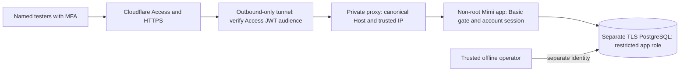

# Phase 4B: private staging deployment package

This is a **release package, not a deployment**. It prepares the existing text-only
community for approved synthetic testers. No provider, DNS record, domain, paid
service, tunnel, public website or external database was created or modified.
Payments, signup, photo/video intake and video workers remain disabled. Retain all
[Phase 4A controls](phase-four-a.md) and [media isolation requirements](phase-three-b.md).

## Architecture and provider decision

**Recommended first architecture: a small dedicated Linux VM running the packaged
containers, a separate managed PostgreSQL database with verified TLS, and
Cloudflare Access plus an outbound Cloudflare Tunnel.** There are no inbound app
or proxy ports. The connector verifies the exact Access application audience;
the proxy accepts only that connector and replaces trusted headers. Mimi's Basic
gate remains independent. A dedicated domain/Cloudflare account and an operator
capable of patching/backing up the VM are prerequisites, not supplied resources.



| Choice                  | Application and operations                                                                                                                                                                                                                                                          | Mimi-specific decision                                                                                                                                                                                                                                                                                                |
| ----------------------- | ----------------------------------------------------------------------------------------------------------------------------------------------------------------------------------------------------------------------------------------------------------------------------------- | --------------------------------------------------------------------------------------------------------------------------------------------------------------------------------------------------------------------------------------------------------------------------------------------------------------------- |
| Render                  | Managed Docker web services/PostgreSQL, HTTPS/custom domains, environment secrets and private-network offerings are the relevant candidates. Current plan, ingress restrictions, verified DB certificates, resource limits and probe-header behavior require operator confirmation. | Likely simplest for ordinary web-app operations, but **not verified compatible** with this package's complete private ingress/header/probe requirements. A public `onrender.com` origin must never bypass named-tester access. Do not enable Git push auto-deploy.                                                    |
| Railway                 | Official documentation confirms Dockerfile builds, environment-scoped private networking, service variables and custom domains with TLS. Its standard healthcheck uses `healthcheck.railway.app` and expects 2xx; variables may also be delivered during builds.                    | Standard probes fail Mimi's canonical Host/Basic gate. Never weaken that gate or expose build-time app secrets to accommodate them. A separate approved private connector/proxy and probe design would need verification. Compose import is partial, not evidence this Compose file works there.                      |
| Dedicated VM/containers | Operator owns patching, firewall, secrets, capacity, monitoring, image pulls and recovery. Docker limits and networks are explicit. A separate managed DB avoids running durable PostgreSQL inside this app stack.                                                                  | Simplest **complete access boundary to reason about for this package**: no provider public app URL, outbound-only connector, exact peer/header rules, and internal authenticated readiness. It requires more host maintenance than a PaaS. This is the selected recommendation, not a claim of live provider testing. |

Start planning around 2 vCPU/2 GiB for the app, with additional proxy/OS headroom
and a separately sized DB. Measure load before treating that as capacity. This
image has no FFmpeg, Bubblewrap, media bucket or worker. Future media processing
belongs on a separately reviewed host with private networking, independent
credentials, scanner contracts and verified namespaces/cgroups. Neither PaaS
worker support nor a container alone proves native isolation.

Research used official Railway docs at source commit
`72354493198302677fb6be6c692dd75c64cae2c6` ([Dockerfiles](https://docs.railway.com/guides/dockerfiles),
[networking](https://docs.railway.com/guides/private-networking),
[healthchecks](https://docs.railway.com/guides/healthchecks)) and Cloudflare docs at
`84e81878caad5f7917f36d40f77a88e815f2a2d1`
([origin parameters](https://developers.cloudflare.com/cloudflare-one/networks/connectors/cloudflare-tunnel/configure-tunnels/origin-parameters/),
[Access policies](https://developers.cloudflare.com/cloudflare-one/access-controls/policies/),
[MFA](https://developers.cloudflare.com/cloudflare-one/access-controls/policies/mfa-requirements/)).
Their official Git repositories were readable; the documentation websites were
blocked by this environment's egress proxy. Render's current docs could not be
retrieved: [Docker](https://render.com/docs/deploy-docker),
[private networking](https://render.com/docs/private-network),
[PostgreSQL](https://render.com/docs/postgresql-creating-connecting) are operator
verification references. No provider account, live policy or price was verified.

## Container build and image review

The Dockerfile pins Node 24.19.0 Debian/glibc by digest and pnpm 9.15.9, installs
the frozen lockfile, builds separately and copies production dependencies and
runtime outputs. Build cache, development browser tools and unused musl native
binaries are omitted. Native Sharp/glibc remains. The runtime uses UID 1000,
`pnpm start` and the existing pre-bind validation; it has no `.env`, Git metadata,
test accounts, operator scripts or development wrapper. No runtime app credentials
are build arguments. The build-only passwordless DB URL points at a closed
loopback port, since route collection imports the DB module without connecting.

```sh
git switch codex/mimi-private-staging-phase-four-b
git status --short
release_sha=$(git rev-parse HEAD)
docker build --tag "mimi:staging-$release_sha" .
docker run --rm --entrypoint node "mimi:staging-$release_sha" \
  -e 'if(process.getuid()===0)process.exit(1);require("sharp")({create:{width:1,height:1,channels:3,background:"pink"}}).webp().toBuffer().then(b=>{if(!b.length)process.exit(1)})'
```

Google Fonts need verified HTTPS access to `fonts.googleapis.com` and
`fonts.gstatic.com` during build. Corporate proxies can supply a **public CA
bundle**, never application secrets:

```sh
docker build --secret id=build_ca,src=/absolute/trusted-build-ca.pem \
  --tag "mimi:staging-$release_sha" .
```

In this cloud environment Docker needed a writable `DOCKER_CONFIG` outside the
checkout and a build-only DNS mapping for the environment's proxy. Resolve that
proxy using the existing environment, not a hardcoded production IP. Passing
proxy build arguments is only appropriate for approved noncredentialed proxies;
use supported secret mounts for credentialed build access. TLS verification was
retained. This is local tooling configuration, not a hosting requirement.

The current runtime retains Next's validated TypeScript entrypoint and production
dependency graph rather than a different standalone server. It is smaller than
the builder but not a distroless/minimal-framework image. Rebuild pinned images
for updates, scan the final OCI image with the operator's trusted scanner, record
the resulting immutable digest/SBOM and review findings before release. The npm
audit gate does **not** certify base OS packages or replace OCI scanning.

The container supervisor keeps `pnpm start` alive and forwards shutdown to the
validated start process, allowing Next to drain in-flight requests. Sending the
signal only to pnpm terminated active requests; the packaged supervisor fixes
that behavior. The runtime copies only the configuration/role modules needed by
that entrypoint, not database seeds or offline operator scripts. Build from a
clean, reviewed tracked commit and retain its image digest as the release unit.

After explicit registry approval only, tag/push that reviewed build to the private
registry, then set `MIMI_IMAGE=registry.example/your-project/mimi@sha256:...` on the
host. The ellipsis is a placeholder, not a fabricated digest. No image was pushed
to a registry here. CI builds/checks images but never pushes or deploys them.

## Separate PostgreSQL: exact operator workflow

Create a brand-new staging database; never import production snapshots/accounts.
Use a provider-maintained certificate-verified TLS endpoint with network access
limited to the VM and audited operators. Private networking alone is not TLS.
Configure private `PGSERVICEFILE`/`PGPASSFILE` (0600), service
`mimi-staging-operator`, `sslmode=verify-full`, the provider CA and exact certificate
hostname. Do not put database passwords in command history or repository files.

The following SQL is a **manual reviewed operation** using an administrative
connection to a maintenance database. Adapt only after verifying the provider's
role/ownership model. Do not run against an existing production database:

```sql
CREATE ROLE mimi_staging_migrator LOGIN NOSUPERUSER NOCREATEDB NOCREATEROLE NOINHERIT NOBYPASSRLS;
CREATE ROLE mimi_staging_app LOGIN NOSUPERUSER NOCREATEDB NOCREATEROLE NOINHERIT NOBYPASSRLS;
-- In psql, set each independent password with \password (interactive, not SQL literals).
\password mimi_staging_migrator
\password mimi_staging_app
CREATE DATABASE mimi_staging OWNER mimi_staging_migrator;
```

Use the migrator connection for migrations and controlled bootstrap, never for the
web service. It must own the migration-created tables; the app must not be a
member of it or any privileged role. Through the provider's secret environment,
set `POSTGRES_URL` to the migrator URL with `sslmode=verify-full` and
`NODE_EXTRA_CA_CERTS` to the trusted CA file. In a reviewed checkout:

```sh
pnpm install --frozen-lockfile
pnpm db:migrate
# Verify the journal/schema; repeat is nondestructive and must apply nothing.
pnpm db:migrate
# The psql service below connects specifically to mimi_staging as the owner.
psql service=mimi-staging-operator --set ON_ERROR_STOP=1 \
  --set db_name=mimi_staging --set app_role=mimi_staging_app \
  --file deploy/staging/grants.sql
```

`grants.sql` runs transactionally, checks the exact staging DB name and app role,
refuses privileged/inheriting/member/owner app roles, revokes inherited PUBLIC
table/schema grants, and assigns explicit table permissions. It grants no app
staff writes, audit rewrites/deletions, user hard deletion, schema creation,
ownership or future-table defaults. It changes grants only, never drops tables,
data or databases. Review this dedicated-database assumption and rerun the grants
review after each migration. Unexpected tables get no implicit app access.

Now switch the **operator process** to the application's restricted URL and verify:

```sh
APP_ENV=staging STAGING_DATA_ISOLATED=true STAGING_DATABASE_NAME=mimi_staging \
  node scripts/staging-operator.mjs --command verify
```

This checks actual TLS and the shared Phase 4A role predicate without logging
connection strings. Hosted startup repeats its app-role check. Keep root/operator
URLs out of the container environment and filesystem. A separate manual staff
operator may instead receive the narrowly reviewed account-lock/staff/audit
permissions needed by `scripts/platform-staff.mjs`; never expose that tool as an
HTTP endpoint or hand its credentials to the app.

## Synthetic accounts and secrets

With signup closed, prepare three dedicated synthetic accounts in a private JSON
file **outside** the checkout. Use independent random passwords of 20–72 UTF-8
bytes and `@example.test` emails. Example structure (empty passwords must be
replaced securely; they are not working credentials):

```json
[
  {
    "kind": "creator",
    "name": "Synthetic Artist",
    "email": "stage-artist@example.test",
    "password": ""
  },
  {
    "kind": "member",
    "name": "Synthetic Neighbor",
    "email": "stage-neighbor@example.test",
    "password": ""
  },
  {
    "kind": "moderator",
    "name": "Synthetic Moderator",
    "email": "stage-reviewer@example.test",
    "password": ""
  }
]
```

Set `STAGING_TESTER_FILE` to its absolute private path, chmod 0600, inject the
migrator/operator URL and trusted CA in the operator process, and run:

```sh
APP_ENV=staging STAGING_DATA_ISOLATED=true STAGING_DATABASE_NAME=mimi_staging \
  node scripts/staging-operator.mjs --command testers --apply
```

All three user/team/owner-membership records are created in one transaction with
bcrypt hashes. Existing emails cause refusal/rollback, never password overwrite.
No staff role is assigned. Record the returned synthetic moderator ID, then run
the existing **separate manually authorized** provisioning workflow:

```sh
node scripts/platform-staff.mjs --action grant --user-id SYNTHETIC_ID \
  --role moderator --operator APPROVED_OPERATOR_LABEL \
  --reason 'Approved synthetic staging smoke reviewer.'
```

The reason/ID above must be filled by the operator; no public staff registration
exists. Require MFA/individual identity at Access for all humans, especially staff.
Keep bootstrap/tester files off the host app image and restrict operator access.
Rotate/delete test credentials according to the reviewed retention plan; this
package provides no external database reset or destructive cleanup command.

Review `.env.staging.example` and Phase 4A's complete variable inventory. Runtime
requires independent strong `AUTH_SECRET`, `STAGING_ACCESS_PASSWORD` and a strong
`HEALTHCHECK_TOKEN` for this container's private readiness probe, plus the restricted
TLS `POSTGRES_URL`, canonical HTTPS `BASE_URL`, exact `TRUSTED_ORIGINS`,
`SESSION_COOKIE_SECURE=true`, `TRUSTED_CLIENT_IP_HEADER=x-mimi-client-ip`, Basic
username and verified `STAGING_DATA_ISOLATED=true` attestation. Set all of:

```dotenv
APP_ENV=staging
NODE_ENV=production
PAYMENTS_ENABLED=false
SIGNUP_ENABLED=false
MEDIA_UPLOADS_ENABLED=false
VIDEO_UPLOADS_ENABLED=false
VIDEO_WORKER_ENABLED=false
```

Leave storage/scanner settings absent for text-only staging. Do not carry over
local storage, development-manual scanning or development-prlimit. Stripe keys
remain absent/unnecessary. Deliver secrets through the provider/host secret
manager; restrict any materialized runtime env file to 0600. Never use
`NEXT_PUBLIC_`, Docker build arguments, `docker inspect` environment dumps or
`docker compose config` without `--quiet` to display secrets. Docker host/root
administrators can read container secrets; host access is a privileged boundary.

## Private access and manual release

Everything in this section requires explicit operator approval; do not run it as
part of CI, a push hook or automatic onboarding:

1. Approve the hosting account, resource sizes/region/budget, separate DB, existing
   domain or domain purchase, DNS/HTTPS and authorized operators. Review backups,
   OS/OCI security findings and migrations before creating anything.
2. Configure an Access self-hosted application for the **whole staging hostname**,
   including every path. Allow only named tester identities/groups; require MFA
   (prefer hardware keys for staff), short sessions and revocation procedures.
   Do not add public, wildcard, path-based or OPTIONS bypass rules. Verify policy
   evaluation with allowed and denied identities; an obscure URL is not a gate.
3. Create an outbound connector under separate approval. Copy
   `deploy/staging/cloudflared.example.yml` outside the repo, fill the exact tunnel
   ID, hostname, Access team and audience, and supply its private credentials file.
   `originRequest.access.required=true` validates Access JWTs at the connector;
   missing or wrong audience must be denied. Validate config with the pinned
   cloudflared image before exposing DNS. No live connector was tested here.
4. On a dedicated Docker host, set `MIMI_IMAGE` to the reviewed image digest,
   `STAGING_HOSTNAME` to the canonical HTTPS hostname (standard 443),
   `STAGING_RUNTIME_ENV_FILE`, `DATABASE_CA_FILE`, `TUNNEL_CONFIG_FILE` and
   `TUNNEL_CREDENTIALS_FILE` to absolute secure paths. CA bundles are public trust
   material; verify their source. Ensure files are readable by the relevant
   non-root container UID without making secrets world-readable. Docker file
   binds and user namespaces need host-specific permission review.
5. Review `deploy/staging/compose.yml`. It publishes **no ports**, applies
   read-only root filesystems, bounded tmpfs, app CPU/memory/PID limits, a 45-second
   shutdown grace, dropped capabilities and no-new-privileges. Confirm the fixed
   `172.30.44.0/28` tunnel subnet does not collide; if changed, update the proxy's
   exact trusted connector address too. Do not attach untrusted peers or Docker
   sockets to either network. Keep the DB outside this stack.

```sh
docker compose -f deploy/staging/compose.yml config --quiet
# Public repository template only (not a secret); readable by proxy UID 101.
chmod 0644 deploy/staging/nginx.conf deploy/staging/nginx.conf.template
# Validate runtime settings without printing values or starting a listener:
docker compose -f deploy/staging/compose.yml run --rm --no-deps app pnpm config:check
# Only after reviewed migration, grants, secrets and access policy approval:
docker compose -f deploy/staging/compose.yml up -d app proxy tunnel
docker compose -f deploy/staging/compose.yml ps
docker compose -f deploy/staging/compose.yml exec -T app node scripts/container-health.mjs
```

The proxy accepts only the connector's dedicated IP, requires a valid forwarded
client address, sets canonical Host and overwrites scheme/IP/forwarding headers.
It disables caches and body buffering, bounds text request size, and does not log
request URLs/headers/IPs. It passes Basic authorization to Mimi. Internal Docker
HTTP is acceptable only on the dedicated single-host trusted networks shown;
cross-host links need separately verified TLS. Maintain provider/edge log
redaction too. Never publish the app/proxy ports, enable a provider default public
app URL, or treat forged forwarding headers as proof of trusted ingress.

The healthcheck authenticates to `/api/admin/health` over internal loopback with
canonical Host, Basic credentials and the independent health token. It returns no
diagnostic output; failures mark the container unhealthy. It does not add a
public health bypass. `/api/health` remains gated liveness only. Text-only
readiness expects DB and role ready, optional media services disabled. Docker
does not automatically restart an unhealthy running container: alert and review
the cause; restart policy only handles exits.

Before inviting testers, verify HTTPS/cookies, named identity/MFA, missing/wrong
Access audience denial, Basic denial **after** successful Access, noindex/no-store,
app readiness, closed signup and unavailable uploads/payments. From an external
network, confirm the VM public IP, default provider URLs, proxy port 8080, app port
3000 and DB are inaccessible. Test all APIs, assets, unknown routes and media;
do not carve out health or static assets. Capture private operator evidence
without credentials, cookies, emails or source media.

## Reusable non-destructive staging smoke

`scripts/staging-smoke.cjs` connects through the actual website, uses real form
login/logout and profile editing, and exercises HTTP APIs for the rest. It does
not accept DB URLs, mint sessions, grant staff, reset databases or hard-delete
records. It creates synthetic posts, reports and audit entries and retains them.
Run only with dedicated synthetic accounts and explicit authorization to write
test content. Profile edits revoke listing approval; a distinct synthetic
moderator reviews the exact saved profile/post revision before approval.

Prepare a separate 0600 smoke JSON, outside the repo/app image:

```json
{
  "baseUrl": "https://staging.example.invalid",
  "basicUsername": "tester",
  "basicPassword": "",
  "accounts": []
}
```

Fill `accounts` from the same three synthetic accounts above. For unattended
external smoke, a **separately approved**, short-lived, application-scoped Access
service identity may supply `accessClientId` and `accessClientSecret` in that
private file. Human tester/staff policies still require named identities and MFA;
automation credentials are not proof of human MFA. Revoke the service identity
after use and never configure public bypass. Interactive human Access/MFA and
direct-origin checks remain mandatory manual evidence.

```sh
pnpm exec playwright install --with-deps chromium
STAGING_SMOKE_FILE=/absolute/private/smoke.json \
STAGING_SMOKE_ALLOWED_ORIGIN=https://staging.example.invalid \
  node scripts/staging-smoke.cjs
```

The exact allowed origin prevents accidental writes to a different site. External
targets require HTTPS with normal certificate verification. Never set
`ignoreHTTPSErrors`/TLS verification bypasses. No traces/screenshots are captured
by default. Failures name only the bounded test phase/status, not response bodies,
cookies, passwords or accounts. Smoke includes public/Basic denial, availability,
closed signup, three real logins, owner/staff/private boundaries, profile editing,
moderation, text posts, follows/likes/comments/saves, reports/blocking, disabled
upload/payment endpoints, actual 404s, mobile overflow, axe and logout revocation.
Reused synthetic accounts remain subject to normal abuse limits: do not clear
limits to make tests pass. Space runs or provision a fresh approved test set.
Off-origin browser traffic and API redirects are blocked so Basic/Access service
credentials cannot follow a redirect or demo media request to another site.

CI provisions its own accounts through `prepare-staging-smoke.mjs`, which refuses
non-loopback/non-CI infrastructure and grants the moderator via the existing
offline tool. Loopback HTTP is allowed only with `STAGING_SMOKE_FIXTURE=true`;
this mode simulates the trusted HTTPS Origin/forwarding headers. It does **not**
claim a real browser HTTPS, Access, DNS or hosted ingress test. PostgreSQL TLS is
actually verified. The smoke client has no operator DB environment or credential
file requirement, including when used externally.
The loopback simulator is `scripts/staging-smoke-proxy.mjs`, bound only to
127.0.0.1:3002; it forwards to the separate gated test server on port 3001. It is
test infrastructure, not the hosted proxy or a substitute for verified HTTPS.

## CI, backup, rollback and operations

CI remains test-only: frozen dependencies, advisory gate, migrations twice,
TypeScript/build, full PostgreSQL/media suite, browser/axe, the new staging smoke,
Docker build and non-root native Sharp check. It has read-only GitHub permissions
and no deployment/registry/provider credentials. Fresh auth, gate, health, app DB
and smoke-account secrets are masked before use. Raw server logs are **not**
uploaded as artifacts; GitHub's log masks do not sanitize artifact file contents.
On failure, CI prints a bounded status summary instead. Do not enable shell
tracing or upload private env/tester files, traces, cookies or registry auth.
`scripts/ci-run.mjs` also redacts known fixture secrets, newly minted JWTs, Basic
authorization and database URLs from test/browser output while preserving the
child exit code; oversized lines are withheld. Its regression test covers secrets
split across chunks and a failing child command. This is defense in depth, not
permission to log arbitrary sensitive data.

Back up the separate staging DB using an operator-only provider snapshot/PITR
policy and, if approved, encrypted `pg_dump` output. Keep consistent migration
journal/version and image digest metadata. Rehearse restore into a **new isolated
database**, apply/review grants and verify synthetic content/roles before declaring
recovery ready. This task did not run an external backup/restore. Text-only
staging has no media bucket; private-media backup/version retention remains a
separate Phase 4A/3B prerequisite if media is enabled later.

For release/rollback, keep Access closed until smoke and readiness pass, record
the old/new immutable image digests, back up before approved additive migrations,
then change only `MIMI_IMAGE` and recreate the app after review. Roll back to the
previous **Phase 4A-compatible** image digest if validation fails; retain additive
schema/data and rerun readiness/smoke. Do not drop columns/tables, reset databases,
roll below session-version enforcement, or automatically restore over a live DB.
Close ingress and rotate affected credentials/sessions during incidents. Use the
[Phase 4A incident/retention procedures](phase-four-a.md) and named on-call owners.

Monitor container exits/health, bounded log volume, TLS/certificate expiry, Access
denials/revocations, DB connection/latency/backups, authentication limits and host
CPU/memory/disk. Review provider retention/redaction and alert delivery. Budget
research must include VM/DB compute, storage/PITR, data transfer, registry, domain,
Access seats/MFA, monitoring/support and future scanner/isolated worker costs.
No measured prices or free-tier suitability are claimed.

## Verification and outstanding approvals

| Local check                                            | Measured result                                                                                                                                                                 |
| ------------------------------------------------------ | ------------------------------------------------------------------------------------------------------------------------------------------------------------------------------- |
| Frozen install, TypeScript and `pnpm build`            | Passed, including production build inside the final container without runtime/Stripe credentials                                                                                |
| Disposable development and separate staging migrations | Passed, including repeat application; no Phase 4B schema migration added                                                                                                        |
| Full configured suite through the CI output wrapper    | **114 passed, 0 failed, 0 skipped**                                                                                                                                             |
| Six existing browser regressions                       | Passed; **77 clean axe states**, no client errors/mobile overflow across account/demo, video, photos, social, creator and moderation                                            |
| New real-account staging smoke                         | Passed; **12 clean axe states** with actual form logins/logout/profile save, approvals, text/social/report/block/private checks and disabled intake/payments                    |
| Final application image                                | Built; **746,084,429 bytes uncompressed**; UID 1000, glibc Sharp, no local env/wrapper/seed/operator files                                                                      |
| Read-only application container                        | Healthy with restricted app DB credentials and verified fixture TLS; private diagnostics, closed signup, noindex, disabled checkout and unknown-route handling passed           |
| SIGTERM with an in-flight locked DB request            | Response completed after releasing the synthetic fixture lock; container drained and exited **0**                                                                               |
| Compose app/proxy and operator config command          | Passed locally, no published ports and no tunnel started                                                                                                                        |
| Proxy boundary                                         | Trusted peer/Host/client-IP/header replacement/Basic tests passed; wrong Host, missing client IP and untrusted peers denied                                                     |
| Cloudflared example                                    | Pinned-image **offline ingress syntax validation** passed; no tunnel connection/Access identity validation claimed                                                              |
| Grants and operator verification                       | Applied to dedicated synthetic DB; real verified TLS app-role check passed and owner URL was rejected                                                                           |
| Dependency audit                                       | No high/critical findings; one moderate esbuild finding remains in legacy Drizzle Kit tooling. Do not expose Studio/tool servers. OCI/OS scan remains an operator prerequisite. |

The cloud workspace temporarily exhausted disk during repeated image builds;
unused build caches/old task images were reclaimed without touching DB data.
The build was reduced to fewer copy layers, rebuilt successfully, and affected
video/browser checks passed on rerun. The photo browser helper also required its
separate local disabled-storage test server; that was started before rerunning.
Failed/incomplete attempts are not included in the passing results above.

A locally built and gated container is not evidence of a live hosting/Access/MFA
integration. Hosted GitHub Actions for this new branch must still run after push.
Live Render/Railway/VM networking, domains/TLS/Access policies and revocation,
provider DB/CA restrictions, private registry publishing, OCI scanning,
backup/restore and capacity were not exercised. No real media bucket/scanner or
production native sandbox was tested; those services are off and future work.

Operator approval is still required for provider/budget selection, all resource
creation, domain/DNS/HTTPS, private registry publishing, migration/grant execution
against external staging, synthetic staff provisioning, Access policies/tunnel,
secret delivery, backups/restore and the actual release. Public signup, payments,
media intake and native workers remain out of scope. No destructive migration was
added. No external database was reset or deleted.

Remaining production blockers include live ingress/direct-origin/MFA proof,
provider TLS and least-privilege validation, OCI/OS patch review, tested backups
and recovery, capacity/on-call/retention, and reviewed age/consent/privacy/child
safety/reporting procedures. Media additionally needs independently verified
private storage, scanners, human moderation and native worker isolation. This
package makes no legal-compliance or production-isolation claim.
